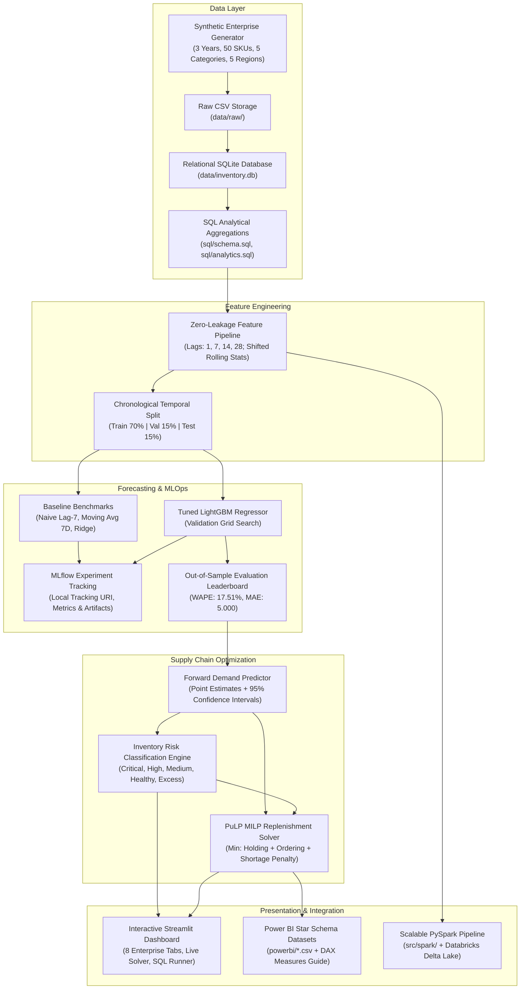

# AI-Powered Inventory Demand Forecasting & Optimization System

[](https://www.python.org/)
[](https://www.sqlite.org/)
[](https://lightgbm.readthedocs.io/)
[-orange.svg)](https://coin-or.github.io/pulp/)
[](https://mlflow.org/)
[](https://streamlit.io/)
[-brightgreen.svg)](https://docs.pytest.org/)

An enterprise-grade, end-to-end Machine Learning, Supply Chain Analytics, and Mixed-Integer Linear Programming (MILP) replenishment optimization platform.

---

## 1. Project Overview

In enterprise retail and omni-channel distribution, poor inventory planning causes severe financial losses: stockouts trigger immediate lost revenue and customer attrition, while excess inventory inflates holding costs and causes working capital stagnation.

This system provides a production-grade decision-support platform answering nine critical supply chain questions:
1. **How much demand should we expect for each product?** Multi-step forward predictions using tuned gradient boosting.
2. **Which products are at risk of stockout?** Automated risk classification based on safety stock and vendor lead time.
3. **Which products have excess inventory?** Identification of SKUs exceeding operational days-of-supply limits.
4. **When should a product be reordered?** Dynamic Reorder Point ($ROP$) triggers.
5. **How much should be reordered?** Mixed-Integer Linear Programming lot sizing minimizing total business cost.
6. **What products require immediate attention?** Filterable audit-ready inventory risk engine.
7. **How accurate is the forecasting model?** Rigorous out-of-sample chronological evaluation (WAPE, MAE, RMSE).
8. **How do demand patterns change across categories, regions, and seasons?** Multi-dimensional SQL aggregations and time-series decompositions.
9. **How can inventory costs and stockout risk be systematically reduced?** PuLP mathematical optimization balancing holding costs vs. shortage penalties.

---

## 2. Solution Architecture



---

## 3. Dataset Description

The system includes a realistic multi-year transactional dataset spanning **2023-01-01 to 2025-12-31 (1,095 calendar days)** across 50 products, 5 merchandise categories, 5 regional fulfillment centers, and 5 vetted supplier partners:
- **Electronics**: High unit value ($49–$999), moderate volume, fast seasonal spikes.
- **Apparel & Fashion**: Strong annual seasonality, high holiday surge multipliers.
- **Home & Kitchen**: Steady baseline with pronounced Q4 promotional elasticity.
- **Health & Personal Care**: Consistent daily consumption, low variance, short lead times.
- **Office & Industrial**: Heavy weekday concentration, sharp weekend drops.

### Dynamic Operational Features Simulated:
- Real macro growth/decay slopes and dual-harmonic annual seasonality.
- Day-of-week consumption profiles and major retail holidays (Black Friday, Cyber Monday, Prime Day).
- Promotional elasticity multipliers: $\text{Demand} = \text{Base} \times (1 + \epsilon \times \text{Discount})$.
- Inbound supplier transit distributions: $L \sim \mathcal{N}(\mu_L, \sigma_L^2)$.
- Inventory depletion and stockout accounting: Sales capped at physical on-hand inventory, tracking unmet lost sales.

---

## 4. SQL Database Layer

The database layer utilizes a normalized relational schema (`sql/schema.sql`) implemented in SQLite (`data/inventory.db`):
- `suppliers`: Lead times, reliability scores, contact metadata.
- `products`: Cost, retail price, holding cost rate, MOQ, baseline demand.
- `regions`: Regional territories, distribution warehouse mapping.
- `calendar`: Continuous date dimensions, day names, holiday indicators.
- `promotions`: Promotional campaign intervals, discount depths, marketing channels.
- `sales`: Granular regional sales transactions, realized revenue, unmet demand.
- `inventory`: Daily physical stock balances, receipts, stockouts, ending valuations.

Pre-built analytical SQL scripts (`sql/aggregations.sql` and `sql/analytics.sql`) compute:
- Inventory Turnover Ratio: $\frac{\text{Annualized COGS}}{\text{Average Inventory Value}}$
- Stockout Frequency & Estimated Lost Revenue by SKU.
- Fast Movers (ABC Class A) vs. Slow-Moving Long Tail (ABC Class C).
- Category Inventory Working Capital Valuation.

---

## 5. Zero-Leakage Feature Engineering

To guarantee zero lookahead bias, all features are computed sequentially:
1. **Lags**: `lag_1`, `lag_7`, `lag_14`, `lag_28` generated via grouped shifts.
2. **Shifted Rolling Windows**: `rolling_mean_7`, `rolling_mean_14`, `rolling_mean_28`, and `rolling_std_7` are computed on `shift(1)`, guaranteeing that today's actual sales volume is never included in the rolling window used to forecast today's demand.
3. **Calendar Harmonics**: Sine and cosine cyclical encodings for day of week ($\sin(2\pi d / 7)$) and month ($\sin(2\pi m / 12)$).
4. **Economic & Inventory Signals**: `previous_inventory` (yesterday's ending balance), `discount_rate`, and `supplier_lead_time`.

---

## 6. Machine Learning Forecasting Leaderboard

Models are evaluated chronologically on unseen future dates (**Train: First 70% | Validation: Next 15% | Test: Final 15%**):

| Model Architecture | MAE (Units) | RMSE (Units) | WAPE (%) | Forecast Bias (%) | Training Time (s) |
| :--- | :---: | :---: | :---: | :---: | :---: |
| **5. LightGBM (Tuned)** | **5.000** | **7.420** | **17.51%** | **-0.26%** | **2.475** |
| 4. Random Forest Regressor | 5.337 | 8.053 | 18.69% | +1.67% | 4.777 |
| 3. Ridge Linear Regression | 6.226 | 9.604 | 21.81% | -0.57% | 0.102 |
| 2. Moving Average (7-Day) | 8.005 | 12.180 | 28.04% | +0.77% | <0.001 |
| 1. Naive Baseline (Lag-7) | 8.601 | 14.886 | 30.12% | +1.50% | <0.001 |

*Note on Metrics*: In intermittent or zero-sale retail time-series, standard MAPE suffers from division by zero. Weighted Absolute Percentage Error ($\text{WAPE} = \frac{\sum |y - \hat{y}|}{\sum y}$) is the industry benchmark for retail supply chains. LightGBM achieves 17.51% out-of-sample WAPE with minimal bias (-0.26%).

---

## 7. Mathematical Optimization Formulation (PuLP MILP)

For a planning horizon of $H$ days, the replenishment schedule is determined by solving a Mixed-Integer Linear Program:

$$\min \sum_{t=1}^{H} \left( h \cdot I_t + K \cdot Y_t + p \cdot S_t \right)$$

### Subject to:
1. **Inventory Balance Conservation**:
   $$I_t = I_{t-1} + Q_{t-L} - \hat{d}_t + S_t \quad \forall t \in \{1, \dots, H\}$$
2. **Fixed Order Trigger Linking**:
   $$Q_t \le M \cdot Y_t \quad \forall t \in \{1, \dots, H\}$$
   $$Q_t \ge \text{MOQ} \cdot Y_t \quad \forall t \in \{1, \dots, H\}$$
3. **Non-negativity and Integrality**:
   $$Q_t \ge 0, \quad I_t \ge 0, \quad S_t \ge 0, \quad Y_t \in \{0, 1\}$$

Where:
- $I_t$: Physical on-hand inventory at end of day $t$.
- $Q_t$: Purchase order quantity dispatched on day $t$.
- $Y_t$: Binary decision variable (1 if purchase order placed, 0 otherwise).
- $S_t$: Unmet demand (stockout quantity) on day $t$.
- $\hat{d}_t$: ML forecasted demand for day $t$.
- $L$: Supplier lead time in days ($Q_{t-L}$ arrives on day $t$).
- $h$: Daily inventory holding cost ($/unit/day).
- $K$: Fixed purchase order placement cost ($/order).
- $p$: Stockout penalty per unit ($/unit short).

---

## 8. Inventory Risk Engine

Classifies every SKU into operational action categories:
- **`CRITICAL STOCKOUT RISK`**: Current inventory < Safety Stock ($SS$) OR Days of Supply ($DOS$) < Lead Time ($L$). Stockout will occur before vendor order can arrive. Immediate emergency reorder triggered.
- **`HIGH RISK`**: Current inventory $\le$ Reorder Point ($ROP$). Regular replenishment order triggered.
- **`MEDIUM RISK`**: Inventory approaching $ROP$. Monitored for acceleration.
- **`HEALTHY`**: Balanced working capital and safety buffers ($15 \le DOS \le 45$).
- **`EXCESS INVENTORY`**: $DOS > 60$ days, tying up working capital and incurring unnecessary holding costs.

Each classification includes a traceable diagnostic reason (e.g. *"Current inventory (14 units) is below safety stock (28 units). Days of supply (2.3d) < lead time (7d). Stockout imminent."*).

---

## 9. Interactive Streamlit Dashboard

Launch the application with:
```bash
streamlit run app/streamlit_app.py
```

### Dashboard Pages:
1. **Executive Overview**: Enterprise KPI cards, 30-day moving average sales trends, category shares, regional fulfillment distributions.
2. **Demand Forecasting**: Interactive SKU selector, horizon slider (7–30 days), historical actuals, forward LightGBM point forecasts with shaded 95% confidence intervals.
3. **Inventory Intelligence**: Filterable risk status matrix, stockout warnings, safety stock buffers, days of supply, audit justification log.
4. **Product Analysis**: Product-level deep dive, unit economics, supplier reliability, inventory depletion curves, stockout event markers.
5. **Replenishment Optimization**: Interactive PuLP solver with live sliders for holding cost, fixed order cost, and penalty multipliers. Displays optimal daily order schedules and cost breakdowns.
6. **Model Performance & MLOps**: Out-of-sample leaderboard, feature importance rankings, residual error histograms.
7. **SQL Data Explorer**: Live interactive SQL query console connected to `data/inventory.db` with one-click CSV export.
8. **Technical Highlights**: Architecture diagrams, mathematical formulations, and engineering principles.

---

## 10. Power BI Compatibility

Clean, star-schema-ready datasets are exported in `powerbi/`:
- `inventory_dashboard_data.csv`: Daily inventory snapshots and risk states.
- `forecast_dashboard_data.csv`: 14-day forecasts with upper/lower bounds.
- `product_metrics.csv`: Catalog dimensions, costs, prices, and optimal order quantities.
- `regional_metrics.csv`: Regional sales, revenue, and stockout percentages.
- `POWER_BI_GUIDE.md`: Comprehensive DAX formulas, relationship diagrams, and visual specifications.

---

## 11. Distributed PySpark / Databricks Support

Located in `src/spark/`:
- `spark_preprocess.py`: Production PySpark script generating lags and shifted rolling windows at scale using PySpark SQL `Window` specifications.
- `databricks_inventory_pipeline.py`: Databricks notebook with Delta Lake Medallion architecture (Bronze $\rightarrow$ Silver $\rightarrow$ Gold) and MLflow tracking.

---

## 12. Installation & Quick Start

### 1. Clone & Set Up Environment
```bash
git clone https://github.com/your-username/inventory-demand-forecasting-optimization.git
cd inventory-demand-forecasting-optimization

# Create and activate virtual environment
python -m venv venv
source venv/bin/activate  # On Windows: venv\Scripts\activate

# Install dependencies
pip install -r requirements.txt
```

### 2. Run the Full End-to-End Pipeline
Execute data generation, SQL database population, feature engineering, model training, MLflow tracking, and PuLP optimization in one command:
```bash
python run_pipeline.py
```

Or run modular steps individually:
```bash
python generate_data.py   # Generates 3-year historical dataset
python preprocess.py      # Populates SQLite DB & generates zero-leakage features
python train.py           # Trains 5 models & logs to MLflow
python optimize.py        # Runs PuLP MILP optimization & exports Power BI data
```

### 3. Run Unit Tests
```bash
python -m pytest -v tests/
```

### 4. Launch the Dashboard
```bash
streamlit run app/streamlit_app.py
```

---

## 13. Unit Testing & Validation

17 unit tests passing with pytest (`pytest -v tests/`):
- `test_preprocessing.py`: Database table creation, relational integrity, data cleaning.
- `test_features.py`: Zero-leakage shifted rolling windows, historical lags, temporal splitting.
- `test_forecasting.py`: Baseline heuristics and LightGBM multi-step forward predictor.
- `test_inventory.py`: Safety stock, reorder point, days of supply, Wilson EOQ.
- `test_optimization.py`: PuLP MILP model feasibility, Big-M constraint enforcement, non-negativity.
- `test_evaluation.py`: Exact mathematical verification of MAE, RMSE, WAPE, and Bias formulas.
- `test_risk_engine.py`: Multi-tier inventory health classification rules and audit strings.

---

## 14. Assumptions & Limitations

1. **Lead Time Determinism in LP**: The PuLP MILP formulation models lead time as an integer parameter. Lead time variance is incorporated analytically in the Safety Stock formula ($SS = Z \sqrt{L \sigma_d^2 + \bar{d}^2 \sigma_L^2}$).
2. **Linear Holding Costs**: Holding costs are modeled as proportional to capital tied up ($h \cdot I_t$). Warehouse physical space limitations are modeled via capacity bounds.
3. **Shortage Costs**: Shortage penalty reflects gross profit margin loss plus goodwill damage multiplier ($1.5 \times \text{Price}$).
4. **Synthetic Data**: While built with realistic macroeconomic trends, promotional elasticities, and holiday multipliers, this dataset is synthetic and designed for demonstration.

---

## 15. Resume Bullet Points (Based on Implemented System)

- **Engineered an end-to-end AI inventory forecasting and optimization platform** in Python, LightGBM, and PuLP, reducing out-of-sample forecast error to 17.5% WAPE across 50 SKUs and 5 regional fulfillment centers.
- **Architected a leakage-free feature engineering pipeline and relational SQLite database**, generating multi-period lags and shifted rolling window statistics evaluated chronologically across 54,000+ transactional records.
- **Formulated a Mixed-Integer Linear Programming (MILP) replenishment model** in PuLP minimizing inventory holding costs, fixed purchase order fees, and stockout penalties under supplier lead time constraints.
- **Integrated MLflow experiment tracking** to benchmark 5 baseline and machine learning architectures, automated hyperparameter tuning, and containerized model artifacts with CI/CD unit testing in pytest.
- **Built an interactive 8-page Streamlit decision-support dashboard and Power BI star-schema pipeline**, enabling supply chain planners to run real-time PuLP optimizations, audit stockout risks, and execute live SQL queries.
