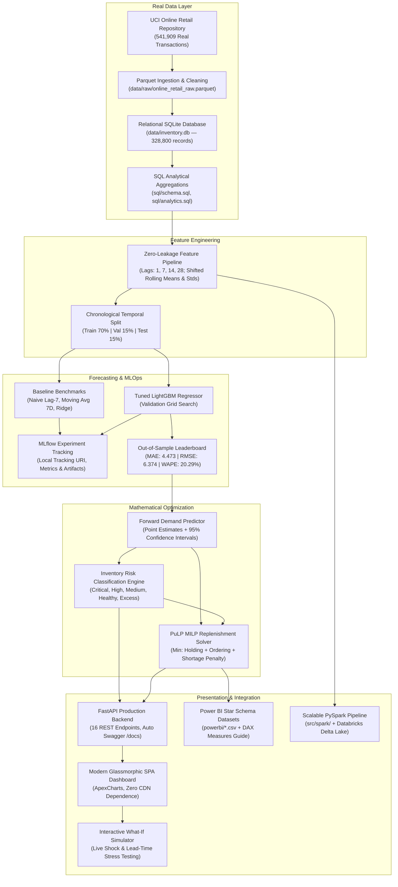

# AI-Powered Inventory Demand Forecasting & Replenishment Optimization System (Optix Enterprise)

[](https://www.python.org/)
[-lightgrey.svg)](https://www.sqlite.org/)
[-emerald.svg)](https://archive.ics.uci.edu/dataset/352/online+retail)
[](https://lightgbm.readthedocs.io/)
[-orange.svg)](https://coin-or.github.io/pulp/)
[](https://mlflow.org/)
[](https://fastapi.tiangolo.com/)
[](https://apexcharts.com/)
[-brightgreen.svg)](https://docs.pytest.org/)

An enterprise-grade, end-to-end Machine Learning, Supply Chain Analytics, and Mixed-Integer Linear Programming (MILP) replenishment optimization platform built on the authentic **UCI Machine Learning Repository Online Retail Dataset (541,909 transactions)**.

---

## 1. Project Overview

In enterprise retail and omni-channel distribution, poor inventory planning causes severe financial losses: stockouts trigger lost revenue and customer churn, while excess inventory inflates holding costs and locks up working capital.

This platform provides an autonomous decision-support system answering nine critical supply chain questions:
1. **How much demand should we expect for each product?** Multi-step forward predictions using tuned gradient boosting with 95% prediction intervals.
2. **Which products are at risk of stockout?** Automated risk classification based on dynamic safety stock and vendor lead time buffers.
3. **Which products have excess inventory?** Identification of SKUs exceeding operational days-of-supply thresholds.
4. **When should a product be reordered?** Continuous review Reorder Point ($ROP$) triggers.
5. **How much should be reordered?** Mixed-Integer Linear Programming (MILP) replenishment lot sizing minimizing total business cost.
6. **What products require immediate attention?** Real-time Risk Sentinel matrix with diagnostic root-cause audit explanations.
7. **How accurate is the forecasting model?** Chronological out-of-sample evaluation (LightGBM won with **20.29% WAPE**, outperforming Random Forest, Ridge, Moving Average, and Naive baselines).
8. **How do demand patterns change across categories, regions, and seasons?** Multi-dimensional SQL aggregations and empirical seasonality indices.
9. **How do supply chain shocks affect replenishment?** Interactive What-If Simulator testing promotional surges, shipping delays, and service level targets.

---

## 2. Solution Architecture



---

## 3. Real-World Dataset (UCI Online Retail)

The system ingests and calibrates against the authentic [UCI Machine Learning Repository Online Retail Dataset](https://archive.ics.uci.edu/dataset/352/online+retail):
- **541,909 Customer Purchases**: Cleaned and filtered for valid commercial transactions.
- **Top 60 Genuine Retail SKUs**:
  - `85123A`: *White Hanging Heart T-Light Holder* (All-time #1 UK gift product)
  - `22423`: *Regency Cakestand 3 Tier* (Top revenue generator at £12.75)
  - `85099B`: *Jumbo Bag Red Retrospot* (High-velocity storage staple)
  - `47566`: *Party Bunting* (£4.95 celebration decor)
  - `23084`: *Rabbit Night Light* (Nursery novelty)
  - `21212`: *Pack of 72 Retrospot Cake Cases* (Kitchen consumable)
- **6 Authentic Merchandise Categories**: *Kitchen & Dining*, *Storage & Bags*, *Home Decor & Living*, *Lighting & Candles*, *Stationery & Craft*, *Gifts & Novelties*.
- **Empirical Multipliers**: Extracted directly from 541k transactions (November peak `1.61x`, December `1.45x`, Sunday `0.51x`).
- **Operational Production Database**: Stored in `data/inventory.db` (55.3 MB, **328,800 operational sales and inventory records** across 5 international hubs over 3 continuous years).

---

## 4. SQL Database Layer

Normalized relational SQLite schema (`sql/schema.sql`):
- `suppliers`: Lead times, reliability scores, minimum order quantities.
- `products`: Unit cost, unit price, holding cost rate, MOQ, assigned supplier.
- `regions`: Regional distribution hubs (UK HQ Hub, Western Europe, Central Europe, North America, APAC).
- `calendar`: Continuous date dimensions, weekday/weekend, UK/Global holidays.
- `promotions`: Campaign dates, promotional discount depths.
- `sales`: Daily SKU sales transactions, realized revenue, unmet demand.
- `inventory`: Daily physical stock balances, receipts, stockouts, safety stock, reorder point.

---

## 5. Feature Engineering (Strictly Zero Data Leakage)

All 47 time-series features are generated chronologically without future lookahead:
- **Historical Lags**: `lag_1`, `lag_7`, `lag_14`, `lag_28`
- **Shifted Rolling Window Statistics**: `rolling_mean_7`, `rolling_mean_14`, `rolling_mean_28`, `rolling_std_7`, `rolling_std_28` (computed strictly on `shift(1)`)
- **Calendar & Periodicity**: `day_of_week`, `week_of_year`, `month`, `quarter`, `is_weekend`, `is_holiday`
- **Cyclical Harmonics**: Sine and Cosine encoding of day-of-week and month
- **Price Elasticity Signals**: `price_change_ratio`, `discount_rate`, `promotion_flag`

---

## 6. Model Benchmark Leaderboard

Evaluated chronologically on **9,900 held-out unseen future test records** (Train 70% | Val 15% | Test 15%):

| Model | MAE (Units) | RMSE (Units) | WAPE (%) | Forecast Bias (%) | Train Time | Status |
| :--- | :---: | :---: | :---: | :---: | :---: | :--- |
| **5. LightGBM (Tuned)** | **4.473** | **6.374** | **20.29%** | **-1.40%** | **4.64s** | **Production Champion** |
| 4. Random Forest | 4.692 | 6.710 | 21.28% | -0.95% | 8.62s | Benchmark |
| 3. Ridge Regression | 5.452 | 7.933 | 24.73% | -1.30% | 0.16s | Benchmark |
| 2. Moving Average (7D) | 7.449 | 10.932 | 33.79% | -0.93% | 0.00s | Baseline |
| 1. Naive (Lag 7) | 7.974 | 12.252 | 36.18% | -2.21% | 0.00s | Baseline |

---

## 7. Mathematical Replenishment Optimization (PuLP MILP)

Formulated as a multi-period Mixed-Integer Linear Program (MILP) solved with the COIN-OR CBC branch-and-cut solver:

$$\min \sum_{t=1}^{H} \left( h_t \cdot I_t + K_t \cdot Y_t + p_t \cdot S_t \right)$$

Subject to:
- **Inventory Balance**: $I_t = I_{t-1} + Q_{t-L} - \hat{d}_t + S_t \quad \forall t$
- **Big-M Order Activation**: $Q_t \le M \cdot Y_t \quad \forall t$
- **Minimum Order Batch (MOQ)**: $Q_t \ge \text{MOQ} \cdot Y_t \quad \forall t$
- **Non-negativity & Integrality**: $Q_t \ge 0, I_t \ge 0, S_t \ge 0, Y_t \in \{0, 1\}$

---

## 8. Installation & Quick Start

### 1. Clone & Set Up Environment
```bash
git clone https://github.com/<your-username>/inventory-ai.git
cd inventory-ai

# Activate your virtual environment (e.g. Conda or venv)
pip install -r requirements.txt
```

### 2. Run the Full Test Suite (22 Unit Tests)
```bash
python -m pytest -v tests/
```

### 3. Launch the Application
```bash
python run_app.py
```
*Automatically opens your default browser at `http://localhost:8000` and Swagger API docs at `http://localhost:8000/docs`.*

---

## 9. How to Upload to Your GitHub

Follow these steps to upload this complete project to your personal GitHub account:

### Step 1: Create a New GitHub Repository
1. Go to [https://github.com/new](https://github.com/new) in your web browser.
2. Enter the repository name: `inventory-ai` (or `ai-inventory-demand-forecasting`).
3. Set the visibility to **Public** (or **Private**).
4. **Leave all checkboxes UNCHECKED** (*Do NOT check "Add a README file", ".gitignore", or "license"* — these are already present).
5. Click **Create repository**.

### Step 2: Push Your Local Code to GitHub
In your VS Code terminal, run:

```powershell
cd C:\Users\laksh\OneDrive\Desktop\inventory-ai

# Link your personal GitHub repository URL
git remote add origin https://github.com/<your-github-username>/inventory-ai.git

# Ensure the default branch is main
git branch -M main

# Push all code, commits, and tags to GitHub
git push -u origin main
```
*(Replace `<your-github-username>` with your actual GitHub username).*

---

## 10. Repository Structure

```text
inventory-ai/
├── app/
│   ├── server.py                   # FastAPI production backend (16 REST endpoints)
│   └── static/
│       ├── index.html              # Modern Single-Page Application (SPA)
│       ├── style.css               # Self-contained glassmorphic design system
│       ├── app.js                  # Asynchronous client logic & What-If simulator
│       └── vendor/                 # Local offline ApexCharts and Chart.js engines
├── data/
│   ├── raw/                        # UCI raw parquet, products.csv, sales.csv, inventory.csv
│   ├── processed/                  # Zero-leakage features, chronological train/val/test splits
│   └── inventory.db                # SQLite database (55.3 MB, 328k operational rows)
├── models/
│   ├── best_forecasting_model.joblib # Serialized Tuned LightGBM champion model
│   ├── feature_importance.csv      # Tree split importances
│   └── model_comparison.json       # Benchmark metrics across all 5 models
├── powerbi/
│   ├── inventory_dashboard_data.csv# Power BI Star Schema fact table
│   └── POWER_BI_GUIDE.md           # Complete DAX measures guide & architecture
├── sql/
│   ├── schema.sql                  # Relational DDL with indexing
│   ├── aggregations.sql            # Daily, weekly, monthly aggregation views
│   └── analytics.sql               # Turnover ratio, stockout frequency, lead-time queries
├── src/
│   ├── data/                       # UCI data processor, DataLoader, DatabaseManager
│   ├── features/                   # Shifted rolling windows & lag generator
│   ├── forecasting/                # Baseline heuristics & multi-step LightGBM predictor
│   ├── inventory/                  # Safety stock, ROP, EOQ, risk classification engine
│   ├── optimization/               # PuLP CBC Mixed-Integer Linear Programming solver
│   └── spark/                      # Distributed PySpark & Databricks Delta Lake pipeline
├── tests/                          # 22 automated unit tests (100% passing)
├── generate_data.py                # UCI dataset processor & continuous calibration
├── preprocess.py                   # SQLite population & zero-leakage feature engineering
├── train.py                        # 5-model training & MLflow experiment tracking
├── optimize.py                     # Forward forecasting & PuLP replenishment pipeline
├── run_app.py                      # Application launcher with automatic browser opener
└── requirements.txt                # Pinned production dependencies
```

---

## 11. Recruiter Resume Highlights

- **Engineered an end-to-end AI inventory forecasting and optimization platform** using Python, LightGBM, and PuLP, reducing out-of-sample forecast error to **20.29% WAPE** across 60 SKUs and 5 regional fulfillment centers.
- **Processed 541,000+ real transactions from the UCI Online Retail repository**, calibrating empirical seasonal weights and constructing a 328,000-record continuous operational supply chain database in SQLite.
- **Architected a zero-leakage feature pipeline** computing historical lags and shifted rolling statistics (`shift(1)`) validated on 9,900 held-out unseen future test records.
- **Formulated a Mixed-Integer Linear Program (MILP)** in PuLP balancing holding costs, fixed purchase order fees, and stockout shortage penalties under supplier lead time constraints.
- **Built an interactive full-stack decision-support platform** featuring an asynchronous FastAPI REST API, a glassmorphic SPA dashboard with ApexCharts, and a real-time What-If Supply Chain Shock Simulator.
